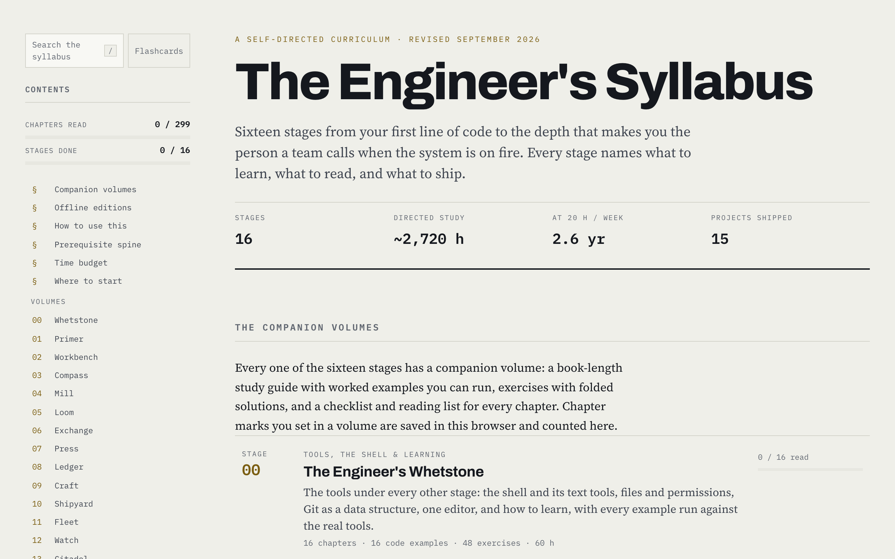

# The Engineer's Syllabus

**Sixteen stages from your first line of code to the depth that makes you the person a team calls when the system is on fire.** A self-directed software engineering curriculum: every stage names what to learn, what to read and what to ship, and every stage has a companion volume, a book-length study guide with worked examples you can run, exercises with solutions, and a checklist and reading list for every chapter.

**[Open it now →](https://hossam-04.github.io/engineers-syllabus/)**



## What's inside

About 2,700 hours of directed study (roughly 2.6 years at 20 hours a week), 299 chapters and 15 shipped projects.

| Stage | Subject | Companion volume |
|---|---|---|
| 00 | Tools, the shell and learning | The Engineer's Whetstone |
| 01 | Programming foundations | The Engineer's Primer |
| 02 | Data structures and algorithms | The Engineer's Workbench |
| 03 | Mathematics | The Engineer's Compass |
| 04 | Computer architecture | The Engineer's Mill |
| 05 | Operating systems and concurrency | The Engineer's Loom |
| 06 | Networking | The Engineer's Exchange |
| 07 | Languages and compilers | The Engineer's Press |
| 08 | Databases | The Engineer's Ledger |
| 09 | Software craft | The Engineer's Craft |
| 10 | Shipping products | The Engineer's Shipyard |
| 11 | Distributed systems | The Engineer's Fleet |
| 12 | Production and infrastructure | The Engineer's Watch |
| 13 | Security | The Engineer's Citadel |
| 14 | AI engineering | The Engineer's Foundry |
| 15 | Mastery | The Engineer's Guild |

The site also has **search** across everything, **flashcards** built from every chapter, and a one-page edition of the whole syllabus. Two interactive courses go with stage 02 and stage 08: [Sorted Again](https://hossam-04.github.io/sorted-again/) for algorithms in Python and [SELECT Again](https://hossam-04.github.io/select-again/) for SQL.

## Read it offline

- **PDF and EPUB editions** of every volume are attached to the [latest release](https://github.com/hossam-04/engineers-syllabus/releases/latest), as two zip files. Single PDFs are also linked from each volume's page.
- Each volume is also a single HTML file in this repository (`*-handbook.html`), as is the study plan (`software-engineering-study-plan.html`) and the whole syllabus in one page (`the-engineers-syllabus-complete.html`). Download one and open it in a browser.

## Your progress

Chapter marks are saved **in your browser only**, on this device, and counted on the home page. Nothing is sent anywhere.

## How it's made

- The volumes are the `*-handbook.html` files at the top of the repository. `syllabus-site/` is built from them by `.build/site-builder/build_site.py`, which also writes the search index and the flashcards.
- `.build/examples/verify_all.py` pulls every code example out of the published pages and runs it: recorded output must match character for character, every other Python block must run or be a known fragment, and the claims the text makes about examples are checked. It needs Python 3.12+, Go, a C compiler, Node, Ruby, PostgreSQL 18 and Redis.
- `.build/editions/build_all.sh` builds the PDF and EPUB editions (macOS, with the Swift toolchain).
- `.build/guild/` and `.build/whetstone/` hold the chapter sources of those two volumes; `.build/tools/make.py` assembles a volume from them.

```bash
python3 .build/site-builder/build_site.py .                       # rebuild syllabus-site/
python3 .build/site-builder/site_check.py syllabus-site /tmp/chk  # structural checks on every page
python3 .build/examples/verify_all.py                             # run every example
sh .build/editions/build_all.sh                                   # PDF and EPUB editions
```

## License

- The **written material** (the study plan, the handbooks, the site's pages, flashcards and figures, and the PDF and EPUB editions) is under [CC BY-NC-SA 4.0](LICENSE-CONTENT): share and adapt it for non-commercial use, with credit, under the same license.
- The **code** (the code examples inside the handbooks, the pages' scripts and styles, and the tooling in `.build/`) is under the [MIT License](LICENSE).

Third-party scripts and fonts are listed in [THIRD-PARTY-NOTICES.md](THIRD-PARTY-NOTICES.md). The reading lists link to many outside courses, books and papers, which belong to their authors.

## Credits

Made by [hossam-04](https://github.com/hossam-04).
